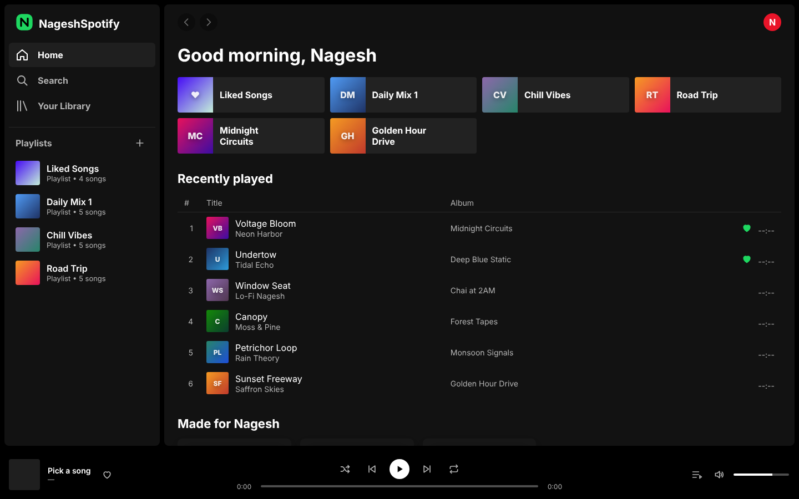
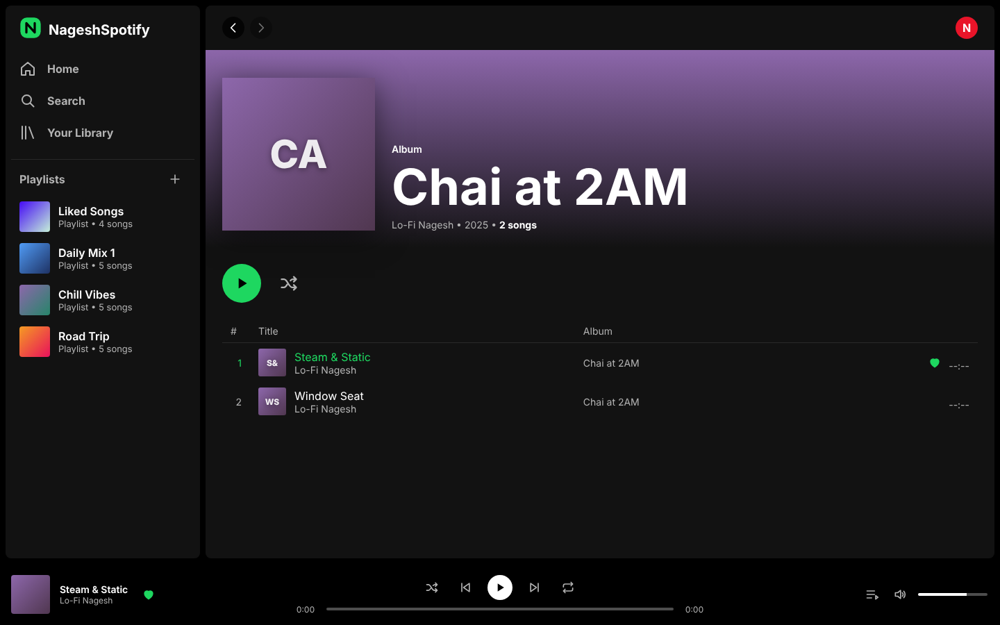
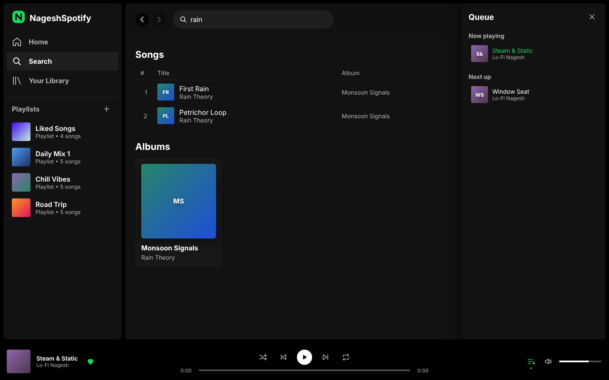
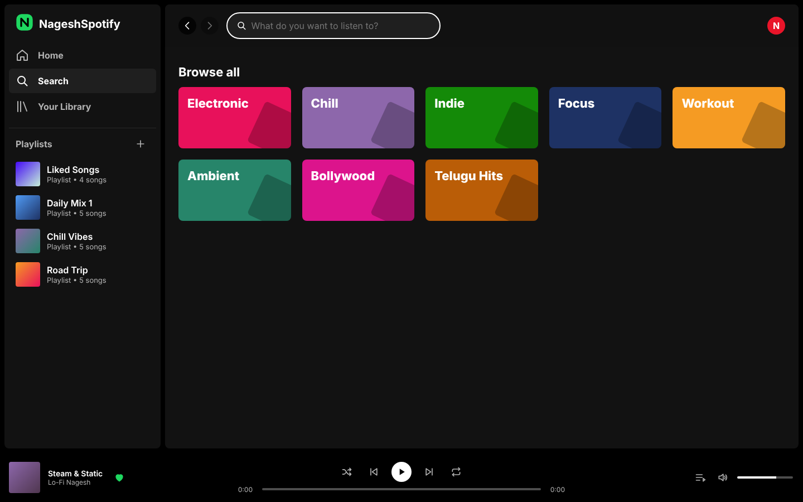
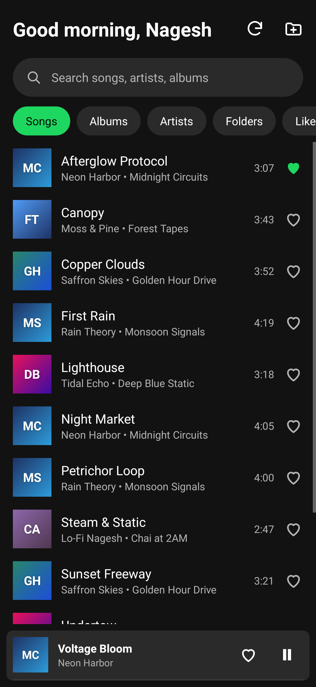
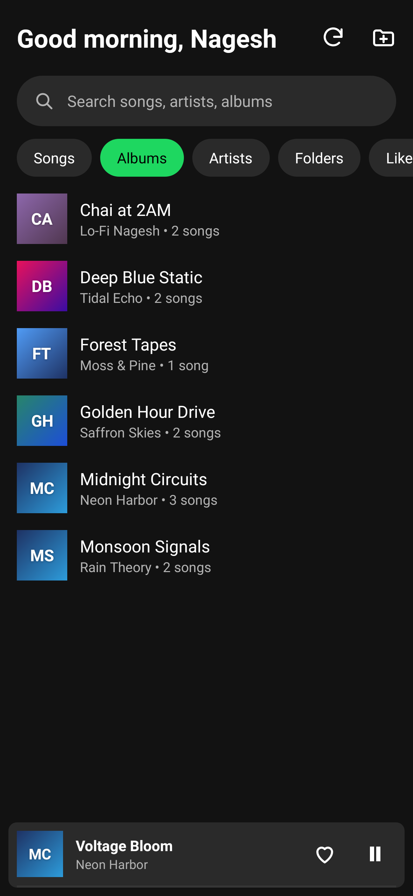
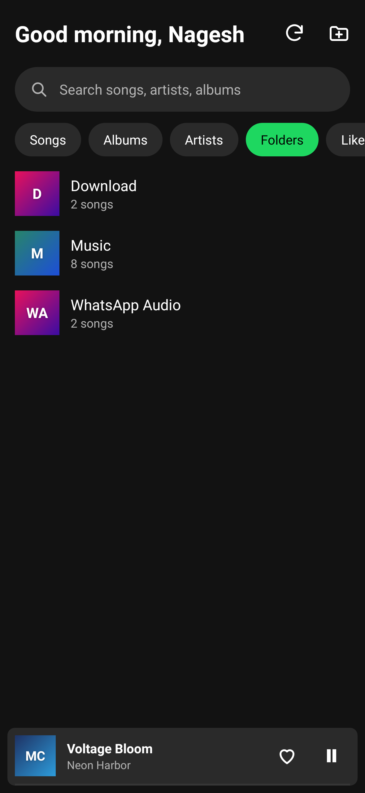
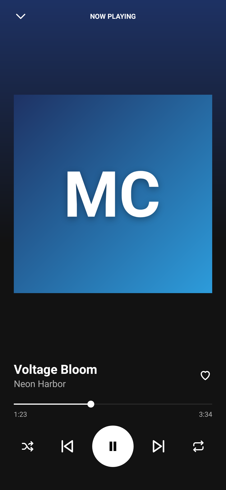

# NageshSpotify

A Spotify-style music player built with **Spring Boot (Java 21)**. The Java backend serves the music catalog and a REST API that stores your likes, playlists and recently played songs in an H2 database. The browser UI is plain HTML, CSS and JavaScript served by the same app.

## Screenshots

**Home**: quick-access tiles, recently played and your playlists



**Album page** with a song playing and liked



**Search** with the queue panel open



**Browse by genre**



## Android app

**[Download NageshSpotify-1.0.apk](downloads/NageshSpotify-1.0.apk)** (62 KB, Android 7.0 or newer)

A native Android app, written in Java, that plays the music stored on your phone. It works offline and doesn't need the server.

| Songs | Albums | Folders | Now playing |
| --- | --- | --- | --- |
|  |  |  |  |

- Finds every audio file on the device (MP3, M4A, FLAC, OGG, WAV and any other format Android can play) and lists it by **song, album, artist or folder**, with search
- **Liked songs**, saved on the phone
- Full **Now Playing** screen: seek, shuffle, repeat (off → all → one), previous/next
- Keeps playing in the **background**, with a media notification and lock-screen, headset and Bluetooth controls. Pauses when headphones are unplugged or a call comes in.
- Shows the album art embedded in your music, or a gradient tile when there is none
- Open any audio file with the folder button, or choose **Open with → NageshSpotify** in a file manager or WhatsApp

### Install

1. Download `NageshSpotify-1.0.apk` on your phone (on GitHub, open the file and tap **Download raw file**).
2. Open it. If Android asks, allow your browser or file manager to **install unknown apps**, then tap **Install**.
3. Open NageshSpotify and tap **Allow** so it can read the music on your device.

If Play Protect warns that it doesn't recognize the developer, tap **More details → Install anyway**. The app is signed with a personal key, not one registered with Google Play.

### Build the APK

The Android project is in [`android/`](android). You can either:

- **Open `android/` in Android Studio** and click Run, or run `./gradlew assembleRelease`. The APK is written to `app/build/outputs/apk/release/`.
- **Build without Android Studio** using the Java build tool. It needs Java 17+ and the Android SDK (platform 34 and build-tools):

  ```sh
  cd android
  java tools/BuildApk.java      # writes build/NageshSpotify.apk
  ```

Both builds sign with `android/signing/nageshspotify.keystore`, so a new APK installs as an update over the old one. That key is only for sideloading; use your own key if you ever publish to the Play Store. Robolectric tests for the app are in `android/app/src/test` (`./gradlew test`).

## Run the web app

Requires Java 21 or newer. Maven is not needed because the project includes the Maven wrapper.

```sh
cd nageshspotify
./mvnw spring-boot:run          # then visit http://localhost:8080
```

Or build a runnable jar:

```sh
./mvnw package
java -jar target/nageshspotify-1.0.0.jar
```

Set the `PORT` environment variable to use a port other than 8080. Your library is saved in `./data/` (delete that folder to start fresh).

Run the tests with `./mvnw test`.

## Features

- **Home**: greeting, quick-access tiles, recently played, playlists, albums and artists
- **Search**: browse-by-genre tiles (each plays a random mix) and server-side search across songs, albums and playlists
- **Your Library**: filter by playlists or albums
- **Album / playlist / artist / Liked Songs pages**: track list with play, like, add-to-playlist and remove-from-playlist
- **Playlists**: create, rename and delete them, and add songs from any track list
- **Player bar**: play/pause, previous/next, shuffle, repeat (off → all → one), seek, volume and mute, a like button and a queue panel
- **Keyboard**: `Space` play/pause, `Shift+←/→` previous/next. Also works with OS media keys (Media Session API).
- Likes, playlists and recently played songs are saved on the server; volume is remembered per browser

## REST API

| Method | Path | Purpose |
| --- | --- | --- |
| `GET` | `/api/catalog` | Albums, tracks and genres |
| `GET` | `/api/library` | Liked track ids, playlists and recently played track ids |
| `GET` | `/api/search?q=` | Matching songs, albums and playlists |
| `GET` | `/api/genres/{name}/mix` | Six random track ids for a genre mix |
| `PUT` / `DELETE` | `/api/liked/{trackId}` | Like / unlike a song |
| `POST` | `/api/playlists` | Create a playlist `{ "name": "...", "trackId": "t1" }` (`trackId` optional) |
| `PATCH` | `/api/playlists/{id}` | Rename a playlist `{ "name": "..." }` |
| `DELETE` | `/api/playlists/{id}` | Delete a playlist |
| `POST` | `/api/playlists/{id}/tracks` | Add a song `{ "trackId": "t1" }` (409 if it's already there) |
| `DELETE` | `/api/playlists/{id}/tracks/{trackId}` | Remove a song from a playlist |
| `POST` | `/api/recent` | Record a play `{ "trackId": "t1" }`; keeps the six most recent |

Errors are returned as RFC 7807 problem details.

## Project layout

| Path | Purpose |
| --- | --- |
| `pom.xml` | Maven build (Spring Boot, Spring Data JPA, H2) |
| `src/main/java/com/nagesh/spotify/catalog` | Demo catalog (albums, tracks, genres) and its endpoints |
| `src/main/java/com/nagesh/spotify/library` | Likes, playlists and recently played: JPA entities, repositories, service, controller and default-playlist seeding |
| `src/main/java/com/nagesh/spotify/SearchController.java` | Search across the catalog and playlists |
| `src/main/resources/application.properties` | Port, database and error settings |
| `src/main/resources/static` | Browser UI: `index.html`, `styles.css`, `app.js` |
| `src/test/java` | API tests |

## Content

Audio streams from the freely distributable [SoundHelix](https://www.soundhelix.com/) example MP3s, so playback needs an internet connection. Album art is generated from CSS gradients. All album, artist and track names are fictional. To use your own music, edit `CatalogService.java` and point each track's `src` at your files.

This is an independent learning project. It is not affiliated with or endorsed by Spotify.
